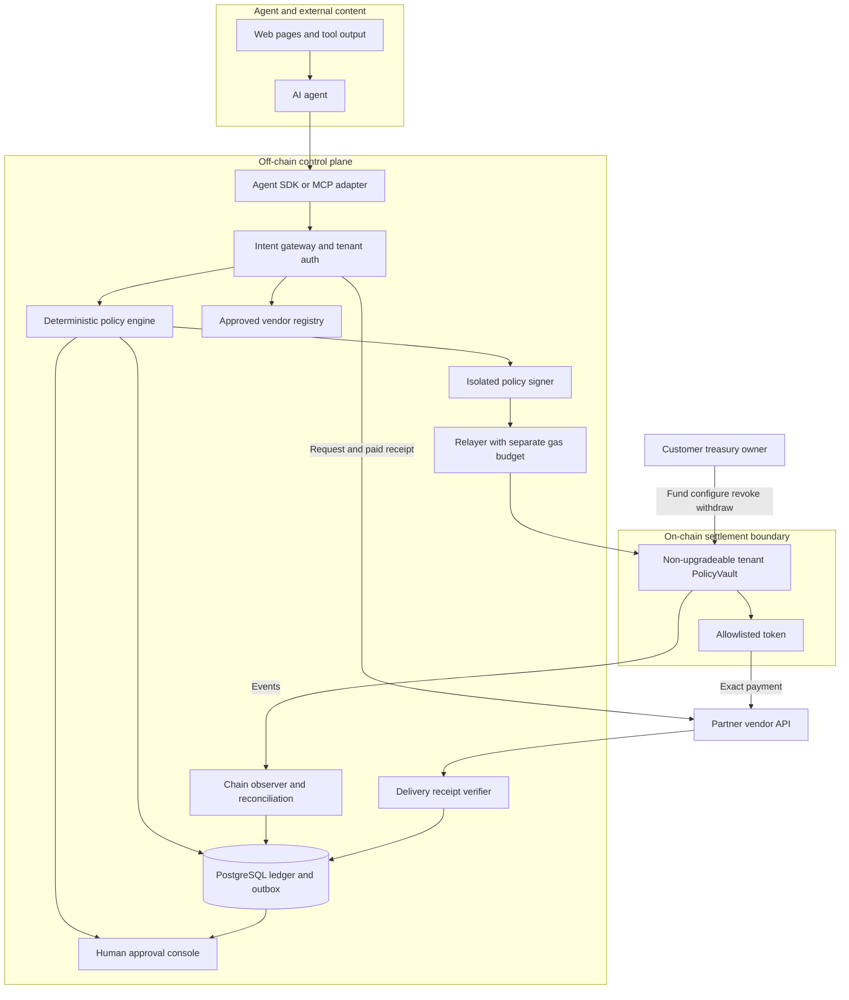
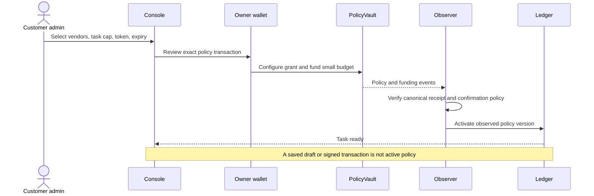
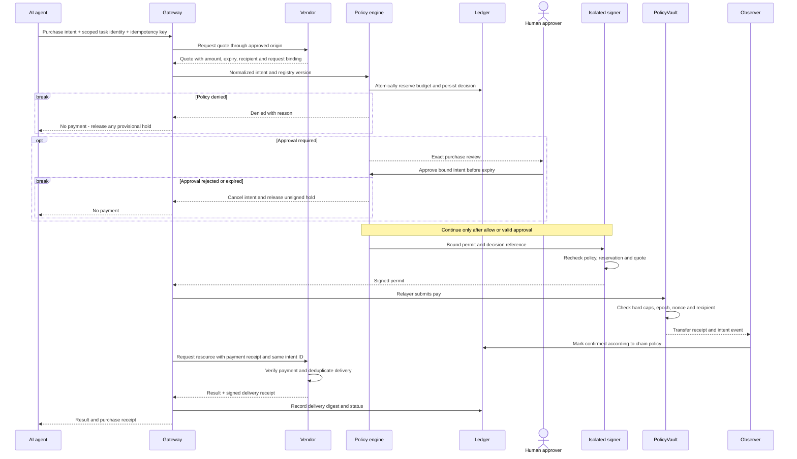
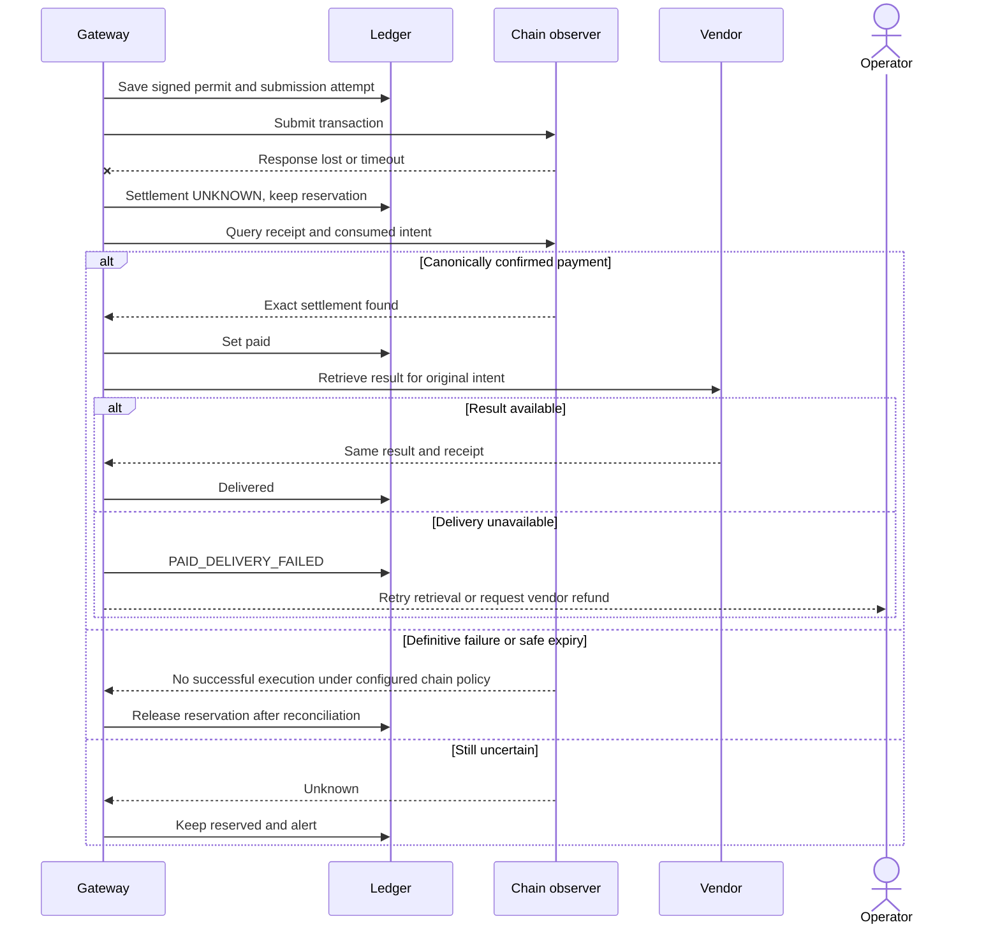
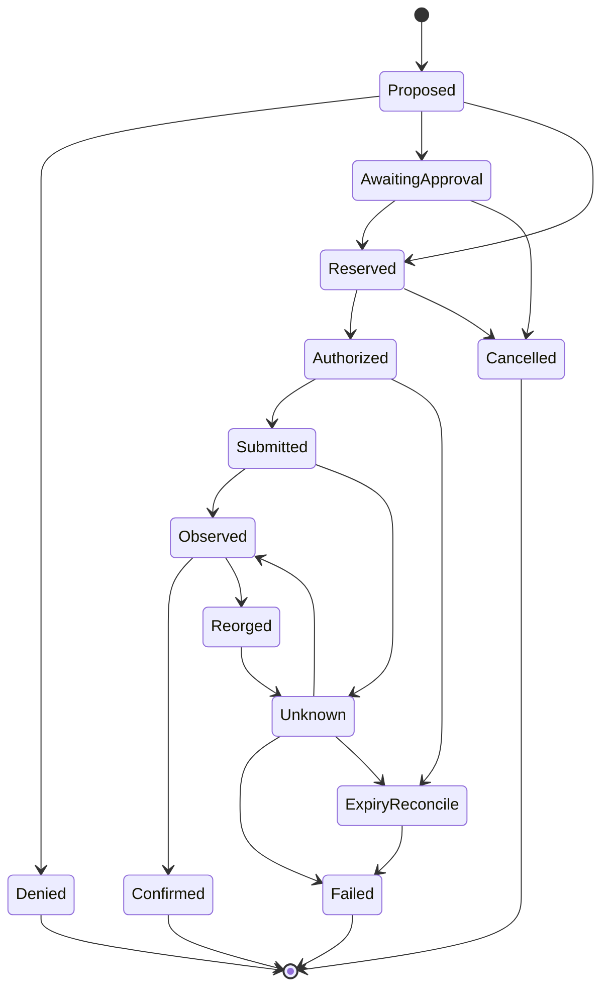

# Agent Spend Control Architecture and Product Design

> **Architecture status:** The project is exploring a CKB-first implementation. This document preserves the original EVM design as a reference; its EVM-specific mechanisms are not a CKB implementation.

**Date:** 9 November 2026  
**Version:** 0.1 — proposed architecture  
**Audience:** founders, engineering leads, pilot partners and security reviewers  
**Scope:** an independent product with no dependency on CellRoute. Implementation, audits and customer traction have not yet been established.

## 1. Product direction

Agent Spend Control is an authorization, execution and reconciliation layer for AI agents purchasing APIs or data with stablecoins. A company assigns a budget to a task; the agent selects tools from an approved list; the system pays only when a transaction satisfies policy and records the relationship between the purpose, payment and service outcome.

Start with companies whose research or data-enrichment agents already use paid APIs. The economic buyer is an engineering/platform lead or AI budget owner; developers and finance teams operate the system. Autonomous trading, lending, swaps, bridges and financial asset purchases are outside the initial scope.

**Value to validate:** reduce the time needed to configure permissions and investigate spending, limit losses when an agent is misdirected, and identify which result each payment purchased. Do not claim to prevent every prompt injection or guarantee AI output quality.

## 2. Market signals and competitive positioning

x402 provides a payment protocol over HTTP. It is an integration foundation; it does not itself resolve internal enterprise policies or the quality of purchased data. [x402 repository](https://github.com/coinbase/x402).

Safe already provides token spending allowances with recurring limits. Its spending-limit documentation states that this mechanism does not restrict recipient addresses. The product therefore needs to add value through task workflows, vendor mapping, approvals, exception handling and accounting, beyond a daily-limit field. This does not imply that the wider Safe ecosystem cannot support recipient policies. [Safe spending limits](https://help.safe.global/articles/3961440620-set-up-and-use-spending-limits).

| Alternative | Existing customer benefit | Gap to validate |
| --- | --- | --- |
| API keys and prepaid credits | Simple, established and no wallet required | Do customers actually need multiple vendors or per-request payments? |
| Wallet and session-key tooling | Signing and delegated permissions | Are usable task budgets, reconciliation and approval workflows missing? |
| x402 facilitator | Verification and settlement for supported schemes | Is there demand for controls before signing and linking payments to usage? |
| Expense and accounting tools | Business expense management | Are agent-level authorization and payment-state tracking missing? |

These are proposed market gaps, not a completed competitive audit or evidence of willingness to pay. Interview at least 10 teams in the same segment; secure two design partners with actual usage and one paid pilot before expanding across chains or frameworks.

## 3. Roles of AI and blockchain

AI handles planning, service selection, usefulness assessment and retry suggestions. These outputs are untrusted inputs for authorization. Authorized people configure policy; the LLM cannot change caps or beneficiaries or approve its own purchases. OWASP recommends least privilege and action controls when agents interact with tools. [OWASP Agent Security](https://cheatsheetseries.owasp.org/cheatsheets/AI_Agent_Security_Cheat_Sheet.html).

Blockchain is useful when the payment asset is on-chain: a contract can enforce token, recipient, task-budget, expiry and replay restrictions independently of the UI and backend. Blockchain cannot verify that an API response is correct, determine user intent or guarantee that a server delivers data.

If a pilot uses only credit cards and API keys, prioritize conventional spend management. Do not introduce blockchain into workflows that do not need on-chain assets. The MVP does not issue a token, require a DAO or use NFTs as spending permissions.

## 4. MVP scope and payment modes

**Primary MVP:** one EVM test network, one allowlisted standard ERC-20, two cooperating vendors and a tenant vault. Consider production only after an audit and pilot. Base Sepolia is a candidate for a technical spike, not a choice already verified against every SDK.

| Mode | Controls | Limitations |
| --- | --- | --- |
| A — PolicyVault and vendor adapter | Contract enforces aggregate budget, recipient, token, task, nonce and validity limits | Vendor must accept receipts from a custom adapter; this is not automatically standard x402 |
| B — Standard x402 adapter, later phase | Gateway policy, protected signer and a payment wallet with a small balance | With an EOA, caps are primarily off-chain; a compromised signer may spend the wallet's entire balance |

Do not describe both modes as having the same security guarantees. ERC-1271 defines contract signature validation, but does not guarantee that every token contract, scheme or facilitator accepts a smart-contract payer. Session keys also require a specific implementation; ERC-4337 does not automatically provide them. [ERC-1271](https://eips.ethereum.org/EIPS/eip-1271), [session delegation](https://docs.erc4337.io/smart-accounts/session-keys-and-delegation.html).

The compatibility spike for mode B must pin the SDK, facilitator, chain, token and scheme, then test payer type, verification, settlement, replay, expired authorization, cancellation and reconciliation. Do not enable production support before these checks pass. Do not add external token approvals to the vault to bypass mode A's restrictions.

## 5. System architecture



Architecture separates control decisions, funds and delivery. Agent process holds only a scoped service identity, never owner/private payment keys. PostgreSQL is source of truth for workflow/reservations; canonical contract events are source of truth for settlement. Redis, if added, is cache/rate limiting only.

| Component | Responsibility | Prohibited behavior |
| --- | --- | --- |
| SDK/MCP adapter | Submit intent, poll status, return bounded result | Sign owner transactions or arbitrary calldata |
| Gateway | Auth tenant/task, validate schema, bind idempotency key | Trust tenant ID supplied only in request body |
| Registry | Pin origin, endpoint, recipient, signing key and revision | Auto-approve vendor from a URL in model output |
| Policy engine | Deterministic allow/deny/approval, atomic reservation | Use LLM score as sole authorization |
| Signer | Independently recheck normalized intent/policy and sign permit | Expose raw signing endpoint to agent |
| Relayer | Submit exact contract call, cap gas expenditure | Select another recipient or silently change quote |
| Observer | Confirm receipt, detect revert/reorg, reconcile unknowns | Treat webhook or HTTP 200 as settlement |
| Delivery verifier | Check receipt schema, task binding, digest and availability | Assert semantic correctness from a hash |

Suggested stack: TypeScript SDK/API, PostgreSQL, queue + transactional outbox, Solidity + Foundry, viem-compatible chain client, isolated signing service and OpenTelemetry. These are design choices; specific versions must be pinned during implementation.

## 6. Identity and policy model

A task is created by an authenticated orchestrator under a customer-approved grant. Agent cannot create unlimited fresh tasks to reset budgets. All grants share the tenant vault's daily/lifetime caps. MVP task grants are registered on-chain by owner; frequent automated grant creation requires a future constrained grant-manager, not giving the policy signer owner power.

```json
{
  "tenantId": "tenant_demo",
  "agentId": "research_agent",
  "taskId": "task_123",
  "chainId": 84532,
  "assetAddress": "<verified-token-address>",
  "vendorIds": ["dataset_vendor_a"],
  "perCallMaxRaw": "250000",
  "taskMaxRaw": "2000000",
  "approvalAboveRaw": "100000",
  "taskExpiresAt": "<unix-seconds>",
  "policyVersion": 1
}
```

Illustration assumes a verified six-decimal token: 250000 raw = 0.25 token. Never infer decimals or USD price from token symbol. All calculations use integer raw amounts. Human approval can permit an amount above an off-chain auto-approval threshold but cannot bypass on-chain task/global caps; changing those requires an owner transaction and a new review.

| Rule | Enforcement |
| --- | --- |
| Token, recipient allowlist, task/global caps, expiry, grant epoch | On-chain and mirrored off-chain |
| Method, vendor origin/path, MIME/data policy, task purpose | Gateway/signer; chain cannot inspect HTTP semantics |
| Approval requirement | Backend and optional approver co-signature flag on task grant |
| Velocity, anomaly signal and provider quality | Off-chain; anomaly engine recommends block/review, not extra authority |
| Cancellation/revocation | Stop new signing immediately; on-chain epoch/revoke becomes effective once included |

Fixed UTC budget windows permit spending on both sides of midnight. Keep independent task/lifetime caps and an optional off-chain rolling-window throttle. Signed permits bind an exact budget window; old-window permits do not execute in a new window.

Policy/signer rotation invalidates old permits but never resets accumulated spending. Daily counters are keyed by token and UTC window, lifetime counters by vault/token, and task counters by stable task identity. Regranting an existing task preserves its spend. Lowering a cap below prior spend blocks additional purchases; increasing it requires an explicit owner transaction. MVP asset configuration is immutable once funded; changing token requires a new vault.

## 7. Smart contract design and invariants

PolicyVault is proposed minimal code with owner management and restricted token transfer; it is not a general wallet or audited product. Owner can fund/withdraw and change grants. Operator signer cannot change owner, destinations, token, caps, pause status or policy epoch.

Conceptual interface:

```text
setTaskGrant(taskHash, budgetRaw, perCallRaw, deadline, approvalRequired)
setMerchant(recipient, allowed)
setPolicy(token, dailyCapRaw, lifetimeCapRaw, policySigner)
revokeTask(taskHash) / incrementPolicyEpoch() / pause()
pay(PaymentPermit, policySignature, optionalApproverSignature)
withdrawToOwner(amountRaw)
```

Permit binds vault, chain, policy epoch, task/grant epoch, exact budget window, intentHash, quoteHash, recipient, token, amountRaw, nonce, validAfter and expiresAt. Use EIP-712 domain separation; replay protection still requires consumed nonces/intent IDs and expiry logic in the contract. [EIP-712](https://eips.ethereum.org/EIPS/eip-712).

When a task requires on-chain approval, an owner-configured approver must co-sign the same permit digest. Policy signer and agent cannot select that approver. In the MVP this flag applies to every payment in the grant; amount-based human thresholds remain off-chain unless explicitly implemented and tested in the contract.

`pay` verifies roles/signatures and every bound field, checks paused/grant/epoch/window/time, verifies recipient/token and caps, marks intent consumed and updates counters, then performs one safe ERC-20 transfer with reentrancy protection. Transfer failure reverts the entire transaction. No arbitrary call, delegatecall, token approval, multicall or bridge entry point. Restrict MVP token behavior: no fee-on-transfer/rebasing tokens; issuer freeze/upgrade risk remains.

Required invariants:

1. A successful settlement never exceeds the grant, daily or lifetime cap active for its window/epoch.
2. The same intent can transfer at most once in the canonical contract state, regardless of relayer retry.
3. Payment goes only to the bound allowlisted recipient and asset.
4. Changing a bound amount, recipient, quote, chain or grant invalidates the authorization.
5. Revoked/expired permissions cannot execute after the relevant on-chain state is effective.
6. Backend compromise alone cannot bypass hard caps; it can still abuse allowed spending up to those caps. This is exposure limitation, not full compromise prevention.
7. Customer owner transactions remain an explicit trust boundary. The owner can intentionally withdraw or change policy; guarantees concern delegated-agent spending.

## 8. Sequence diagram for policy setup



## 9. Sequence diagram for authorized purchase



Partner vendor signs quote fields and implements idempotent result retrieval by intent ID. If vendor cannot provide quote signatures, transport integrity and a pinned registry provide weaker provenance and must be labeled. Contract binds quoteHash but does not validate whether the quote is fair or data useful.

## 10. Timeout and paid without delivery

Payment and HTTP delivery are not atomic. MVP uses pay-then-fetch with vendor retry/retrieval; it does not promise trustless refunds.



Never create a new authorization just because `settle` or HTTP request timed out. Re-submit the same vault intent only if needed; on-chain deduplication prevents a second canonical payment. In x402 mode, same-payment replay and cancellation behavior must be proven for the selected scheme; do not assume vault guarantees carry over.

Refund is a separate incoming transfer from vendor, linked to the original intent and verified independently. Do not replenish gross-spend policy caps automatically from refunds: otherwise refund loops could bypass authorization accounting. Finance can show net cost separately.

For irreversible external delivery, choose an explicit chain finality/confirmation policy per network. A reorg can invalidate an observed payment after data was delivered; mark REORGED, reverse derived accounting, retain the delivery fact and reconcile. No universal number of confirmations is claimed safe for every chain.

## 11. Payment and delivery state machines



Delivery has independent states: NOT_REQUESTED, FETCHING, DELIVERED, FAILED, DISPUTED. Refund has NONE, REQUESTED, OBSERVED, CONFIRMED. Do not compress everything into one `success` boolean. Finality is an operational policy; a deeper reorg triggers an explicit incident even after a previously confirmed state.

Reservation accounting: available = limit − settled gross spend − unresolved reservations. Policy engine uses serializable transactions or locked budget rows; the sum of concurrent reservations cannot exceed the same ledger cap. Contract counters remain the final guard when caches or backend reservations are stale. Outstanding signed permits remain reserved until consumed, invalidated on-chain, or expired with reconciliation proving no canonical spend. Pending approval holds have bounded TTL; signed authorizations require the stronger release rule.

## 12. Data model and API

| Entity | Minimum fields |
| --- | --- |
| Tenant | owner, vault, chain, token, authentication configuration |
| Agent | tenant, workload identity, allowed task grants, disabledAt |
| TaskGrant | taskHash, caps, validity, epochs, observed policy reference |
| Vendor | verified origin, recipient, quote key, endpoint scope, registry revision |
| Intent | tenant/task, canonical request digest, vendor, raw amount, quoteHash, idempotency key |
| Reservation | intent, amount, window, status, expiry/reconciliation state |
| Approval | actor, exact intent digest, decision, expiry, signature where required |
| PaymentAttempt | intent, permit digest, nonce, txHash, chain, status, error |
| ChainObservation | block hash/number, tx index, log index, canonicality, provider |
| DeliveryReceipt | intent, request/result digest, vendor signature, delivery state |
| AuditEvent | actor, action, version, timestamp, immutable export reference |

DB constraints: unique `(tenantId, idempotencyKey)`, reject reused key with a different request digest; unique `(chainId, vault, intentHash)`; distinguish multiple broadcast attempts from one payable intent. Canonical hashes use a specified deterministic encoding and version. Never put secret prompts into a bare public hash: dictionary attacks can reveal low-entropy content. Store encrypted content off-chain; use salted commitments or opaque IDs where necessary.

```text
POST /v1/tasks                         orchestrator role
POST /v1/intents                       agent-scoped role, Idempotency-Key required
GET  /v1/intents/{id}                  tenant-scoped receipt/status
POST /v1/intents/{id}/approve          approver role
POST /v1/intents/{id}/cancel           no claim to undo submitted settlement
POST /v1/agents/{id}/disable           immediate gateway stop; on-chain follow-up
GET  /v1/receipts/{id}                  redacted, exportable reconciliation record
```

Agent tool `purchase_resource` exposes vendorId, resourceId, bounded parameters and taskId; it does not expose arbitrary URLs, recipient addresses or raw signing. Gateway authenticates the task independently. No secret key enters model context, logs or tool output.

## 13. Threat model and operations

| Threat | Control | Residual risk |
| --- | --- | --- |
| Prompt injection requests expensive purchases | Deterministic policy and hard caps; human threshold | Agent can waste its allowed budget |
| Poisoned quote changes payee/chain | Vendor registry, quote/request binding, signer recheck | Approved vendor may be malicious |
| Agent credential stolen | Scoped identity, short TTL, task/global caps, revoke | Authorized actions remain possible before revoke |
| Backend/policy signer compromised | On-chain recipient/task/global limits; isolated signer | May drain all remaining allowed exposure |
| Duplicate retries/concurrent calls | DB uniqueness/atomic reservation + contract intent consumption | Provider may repeat work; vendor idempotency required |
| RPC lies or reorg | Confirm receipt fields, independent-provider checks for anomalies, canonical reconciliation | Shared-provider failure and chain failure remain |
| Endpoint SSRF or redirect | Egress allowlist, DNS/IP checks on every hop, no private ranges, no uncontrolled redirects | Allowlisted host compromise |
| Token issuer freeze/depeg | One verified token, small balances, monitoring | Smart contract cannot remove issuer/economic risk |
| Lost operator signer | Owner rotation and epoch invalidation | In-flight accepted transactions can race revoke |
| Privacy leak | Encrypted requests, access controls, retention policy | Public chain still exposes payment metadata |
| Contract bug | Minimal surface, fuzz/invariants, independent review, small pilot funds | Review is not a proof of no bugs |

Kill switch has two stages: gateway stops new authorizations immediately; owner/guardian pauses vault on-chain. Guardian may pause only, never unpause/withdraw or expand grants. Owner resumes after review. Revocation does not undo a transaction already executed or guarantee precedence in a block.

Use separate keys for treasury ownership, policy signing and gas relaying. Owner should be customer-controlled multisig for production. MVP fixed logic vault has no upgrade proxy; a new version requires opt-in migration by owner. Cloud KMS/HSM must support the actual signing algorithm/API; otherwise use a compatible isolated signer, never silently fall back to a plaintext key in an app server.

## 14. Acceptance tests and observability

Required tests before pilot: 100 concurrent purchase attempts against a smaller budget; same idempotency key with changed body; cross-tenant ID lookup; permit mutation; expired/revoked grant; unknown recipient; token transfer revert; duplicate nonce and intent; signer outage; gas exhaustion; quote expiry during approval; lost submission response; reorg; payment confirmed with failed delivery; spoofed refund; SSRF redirect; malicious content asking to change policy.

Use Foundry invariant/fuzz tests for caps and replay, API integration tests for reservations, and deterministic vendor/RPC fault injection. At least two real vendor-adapter end-to-end flows on testnet are required. x402 production support is a separate compatibility gate.

POC targets, not measured results: 100 percent of authored negative cases reject at intended layer; zero duplicate canonical transfers in retry/concurrency test suite; all paid requests correlate to an intent and delivery state; policy-only decision p95 below 150 ms under a defined load (excludes vendor/chain latency). Do not advertise exactly-once HTTP execution or zero-loss operation.

Metrics: approved/denied/approval-required by reason; reserved exposure; settlement unknown age; paid-but-undelivered amount; task gross spend; refund amount; policy latency; provider errors; gas cost and RPC cost per request. Trace IDs link workflow without exposing prompts or bearer authorizations. Alert on unknown settlement, cap saturation, signer anomalies and mismatched recipient events.

## 15. Business model and fundraising gates

Pricing hypotheses for interviews: monthly platform subscription plus active-agent tiers or receipt volume; enterprise self-hosted signer/integrations as add-ons. Do not charge only basis points on tiny payments. Example assumption: 100,000 purchases at 0.01 USD equivalent total 1,000 USD equivalent volume; a 1 percent fee yields only 10 USD before infrastructure, support and gas. Token price stability and actual fees are separate uncertainties.

Defensibility hypotheses: integrations embedded in customer workflow; reliable exception recovery; policy templates and incident knowledge; vendor onboarding and delivery receipts. Contract code and protocol adapters alone are readily reproducible. Avoid token issuance as a substitute for recurring customer revenue.

| Stage | Evidence required | Stop or narrow scope if |
| --- | --- | --- |
| Discovery | 10 interviews, current spend workflow and identifiable buyer | Customers have no actual agent purchases |
| Design partnership | 2 partners agree to a concrete pilot and provide usage constraints | Interest is only in free demos |
| Technical POC | Testnet end-to-end, negative tests, compatibility matrix | On-chain guarantee depends on unverified signer assumptions |
| Paid pilot | 1 paying customer, repeated weekly usage, measured time/cost outcome | Operational cost exceeds willingness to pay |
| Fundraising | Retention, unit cost, conversion funnel, security plan and roadmap | Only transaction counts from self-funded bots exist |

Do not use gross on-chain volume as addressable revenue. Estimate bottom-up: reachable companies × qualifying paid-agent workflows × annual willingness to pay, with interviews supporting each assumption. Expansion can follow customer demand into teams, providers and chains; it is not an MVP requirement.

## 16. Delivery roadmap for the full project over 12 weeks

The proposed budget is **USD 3,000 for 12 weeks**, allocated at **USD 250 per week** to support development and basic infrastructure. This is a founder-led POC budget, not a full commercial development quote or salary budget. The founder contributes the remaining effort; no paid contributor, external audit or paid review is included. Community feedback will be requested but is not guaranteed.

The plan targets one native-CKB asset, one demo vendor, a minimal operator interface and local/testnet operation. Use existing open-source tooling and local infrastructure where practical. The schedule assumes approximately 30 founder hours per week and must be reassessed after the first working transaction in week 4. UDT, a second vendor and Fiber integration are stretch work, deferred whenever core delivery needs more time.

| Week | Focus | Expected deliverable | Budget |
| --- | --- | --- | ---: |
| 1 | Architecture and setup | Confirm scope, security boundaries and capacity accounting; set up local CKB, dependencies and CI. | $250 |
| 2 | Budget Cell design | Define state, authorization and owner recovery; test valid transitions and reject unauthorized state changes. Request community feedback. | $250 |
| 3 | Spending controls | Implement task/per-call limits, recipient checks and protected capacity; test overspend, replay and counter-reset attempts. | $250 |
| 4 | SDK and local demo | Build transactions and live-Cell discovery; complete one actual local purchase with a deterministic agent and vendor. Reassess remaining effort. | $250 |
| 5 | Backend and persistence | Add scoped authentication, PostgreSQL reservations, idempotency and durable submission handling. | $250 |
| 6 | Recovery and reconciliation | Handle uncertain submissions, concurrent spends, restarts and delivery failure without duplicate payments; tag the local POC. | $250 |
| 7 | Testnet validation | Deploy with test funds after core checks pass; record successful payment, rejection and owner revocation evidence. | $250 |
| 8 | Minimal operator interface | Display task allocation, payment/delivery status and receipts; document one complete user workflow. | $250 |
| 9 | User testing | Invite external developers to try the POC and fix onboarding defects. Explore test UDT support only if core work is complete. | $250 |
| 10 | Core reliability and optional Fiber spike | Prioritize remaining defects. If time permits, assess Fiber compatibility with a strict two-day limit and document its separate security boundary. | $250 |
| 11 | Hardening and documentation | Verify fresh installation and recovery, address available reviewer feedback, record performance evidence and prepare the runbook. | $250 |
| 12 | POC delivery | Deliver the versioned demo, test results, testnet references, known limitations and handover documentation. Report actual costs and remaining work. | $250 |
| **Total** | | **12-week founder-led POC** | **$3,000** |

Weekly amounts are proposed planning allocations, not actual expenses, confirmed funding or an agreed payment schedule. If the founder cannot contribute the assumed time, narrow the scope or extend the timeline rather than treating this budget as full compensation.

The required outcome is a reproducible CKB POC with enforced spending restrictions, an SDK, durable payment reconciliation, a basic operator view and one working agent/vendor example. Testnet deployment is gated on passing script and recovery checks. No real customer funds, mainnet liquidity, production operations or formal security audit are included. Production readiness and optional integrations require separate scope and funding. The EVM-specific mechanisms elsewhere in this reference document must be replaced by CKB-native validation, serialization and signing designs before implementation.

## 17. References

- [x402 official repository](https://github.com/coinbase/x402)
- [Cloudflare agentic payments](https://developers.cloudflare.com/agents/tools/payments/)
- [Safe spending limits](https://help.safe.global/articles/3961440620-set-up-and-use-spending-limits)
- [ERC-1271](https://eips.ethereum.org/EIPS/eip-1271)
- [EIP-712](https://eips.ethereum.org/EIPS/eip-712)
- [ERC-4337 session keys and delegation](https://docs.erc4337.io/smart-accounts/session-keys-and-delegation.html)
- [OWASP AI Agent Security](https://cheatsheetseries.owasp.org/cheatsheets/AI_Agent_Security_Cheat_Sheet.html)

Protocol facts above are sourced; product scope, contract interface, prices, timelines and thresholds are proposed design decisions. Diagrams are Mermaid source for review in Markdown viewers that support Mermaid.
